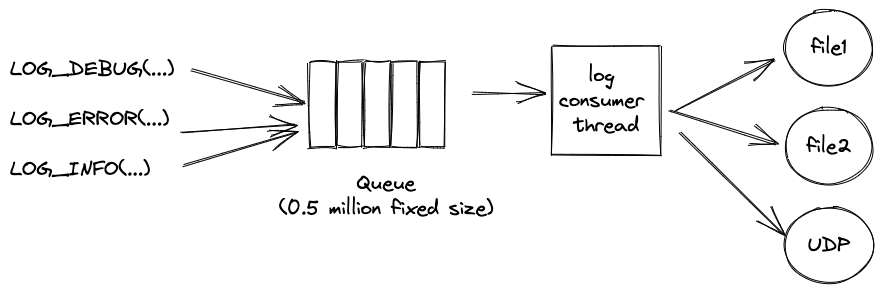
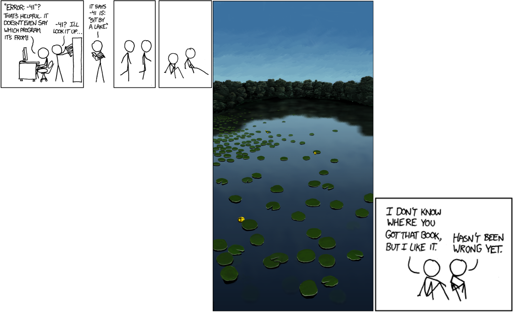

<!--
This presentation is written in markdown, and should be formatted using marp
-->

# All About Logging 

The Ocient logger knows lots of little-known tricks

---
<!-- These settings take effect for the remainder of the slides -->
<!-- header: '' -->
<!-- footer: 'Logging' -->
<!-- paginate: true -->

# Topics

- Log output
- Logging in the code
- Configuring logging
- Logging DDL
- The logging queue
- Logging REST info

---

# Log output

A typical log line

```
[2022-01-12T02:15:27.384957][EDBUG][tcpU007] net::tcp2::tcp2Channel[13]: onReadAvailable(): ...
```

- `[2022-01-12T02:15:27.384957]` timestamp
- `[EDBUG]` loglevel
- `[tcpU007]` thread name (4 chars from `prctl` plus an integer)
- `net::tcp2::tcp2Channel[13]` the logger's name
- remaining text

---

# Logging in the code

```c++
LOG_DEBUG("I am a log");
```

- Assumes the existence of a variable named `LOGGER`

Number of logs in the current code base

ERROR | WARN | VERBOSE | INFO | DEBUG | EDEBUG | EEDEBUG
----- | ---- | ------- | ---- | ----- | ------ | -------
6675  | 570  | 448     | 822  | 3182  | 4514   | 286

---

# Logging in the code

```c++
#include "log.h"

...

log::logSink_t LOGGER(std::string("animals"));
LOG_INFO("I am an animal");
```

```
[2022-01-12T11:44:49.361451][ INFO][role001] animals: I am an animal
```

---

# Hierarchical loggers

```c++
// Construct a mammal
auto m = mammal_t(LOGGER);

...

mammal_t::mammal_t(log::logSink_t &parentLogger) :
 LOGGER("mammal", parentLogger) {}

...

LOG_INFO("I am a mammal");
```

```
[2022-01-12T11:44:49.361460][ INFO][role001] animals::mammal: I am a mammal
```

---

# Hierarchical loggers

```c++
// Construct a mammal
auto m = dog_t(LOGGER);

...

dog_t::dog_t(log::logSink_t &parentLogger) :
 LOGGER("dog", parentLogger) {}

...

LOG_INFO("I am a dog");
```

```
[2022-01-12T11:44:49.361468][ INFO][role001] animals::mammal::dog: I am a dog
```

---

# Hierarchical loggers

Why are they interesting?

**Foreshadowing**:  

```sql
ALTER SYSTEM ALTER LOG LEVEL SET "animals.mammal" EDEBUG; 
```

---

# Scoped Log Sink (`scopedLogSink_t`)

Adds a *transient* string to a logger

- e.g. a UUID or socket

Does not create a new, configurable logging object

```c++
log::scopedLogSink_t LOGGER(parentLogger, std::string("beagle"));
LOG_INFO("I am a beagle!");
```

```
[2022-01-12T13:46:30.464634][ INFO][role001] animals::mammal::dog: (beagle) I am a beagle!
```

---

# Scoped Log Sinks

Can be stacked

```c++
uuid::uuid_t someId = uuid::generateUuid();
log::scopedLogSink_t LOGGER(l4, uuid::to_string(someId));
LOG_INFO("I am a super specific beagle");
```

```
[2022-01-12T13:46:30.464689][ INFO][role001] animals::mammal::dog: (beagle5cc46636-6c31-4967-800a-e059c405eedd) 
            I am a super specific beagle
```

---

# Threshold Logs

```c++
xg::log::thresholdLoggingConfiguration_t<double> thresholdConfig({
    {0.0,  xg::log::logLevel_t::EDEBUG},
    {10.0, xg::log::logLevel_t::DEBUG},
    {60.0, xg::log::logLevel_t::WARN},
});

LOG_THRESHOLD(thresholdConfig, 
              duration, 
              "Dave napped for %f minutes!", 
              duration);
```

---

# Logging File and Line Number

```c++
LOG_FL_INFO("The animal was here");
```

```
[2022-01-12T14:06:15.234757][ INFO][role001] animals: zoo.cpp:108:The animal was here
```

---

# Logging JSON strings

There are no magic macros for this

```c++
LOGGER.log_json(logLevel_t::DEBUG, myJsonString)
```

Will talk more about this later, but will produce correctly formatted JSON in things like query.json

---

# Configuring Logging

rolehostd.conf

```yaml
loggingConfig:
  "":
    allowLevel: debug
    appender:
      logFilePath: /var/opt/ocient/log/rolehostd.log
      truncate: false
      type: file
  query:
    allowLevel: info
    appender:
      format: json
      logFilePath: /var/opt/ocient/log/query.json
      type: file
  security:
    allowLevel: info
    appender:
      format: json
      logFilePath: /var/opt/ocient/log/security.json
      type: file
```

---

# Configuring Logging

Documented (badly) in userdocs.

---

# Configuring Logging

```yaml
"":
  allowLevel: debug
  appender:
    logFilePath: /var/opt/ocient/log/rolehostd.log
    truncate: false
    type: file
```

- `""` The top level (unnamed) logger in the hierarchy
- `allowlevel` what level should be logged here
- `truncate` truncate the file every time rolehostd starts

---

# Configuring Logging

```yaml
 query:
    allowLevel: info
    appender:
      format: json
      logFilePath: /var/opt/ocient/log/query.json
      type: file
```

- `query` all loggers whose first component is `query`
- `format` log each entry in JSON format

---

# Logging in JSON

If you log output normally as a string, it will be output in the `msg` field

```json
{
  "sys": "dboutcher-dev0",
  "timestamp": 1641997987.9659297,
  "thread": "vm  056",
  "lvl": "INFO",
  "src": "animals::mammal::dog",
  "msg": "I am a dog"
}
```

---

# Logging in JSON

If you log using LOGGER.log_json you will get a json document in msg

```json
{
  "sys": "dboutcher-dev0",
  "timestamp": 1641997987.9659297,
  "thread": "vm  056",
  "lvl": "INFO",
  "src": "query::completion",
  "msg": {
    "user": "admin@system",
    "database": "system",
    "default_schema": "",
    "protocol_version": "7.0.1"
```

---

# Configuring Logging

```yaml
etlJobService_t:
  allowLevel: info
  appender:
    logFilePath: /var/opt/ocient/log/etl.log
    truncate: false
    type: file
  exclusive: true
```

- Log all etlJobService_t log entries to the etl.log file
- `exclusive` means do *not* also send them to other log destinations (e.g. rolehostd.log)

---

# Configuring Logging

```yaml
loggingConfig:
  "":
    allowLevel: debug
    appender:
      logFilePath: /var/opt/ocient/log/rolehostd.log
      truncate: false
      type: file
    appenders:
    - appender:
        allowLevel: info
        format: gelf
        port: '12201'
        server: graylog-dev
        type: udp
```

In addition to logging to rolehostd.conf, send over the network via UDP to graylog

---

# Logging defaults

Log INFO level logs to /var/opt/ocient/rolehostd.conf

We should never use numbers when configuring logging any more, and I reserve the right to change the existing ones

---

# Logging DDL

Introduced in v18, ability to change log levels through DDL

```sql
ALTER SYSTEM ALTER LOG LEVEL SET 'ALL' = 'DEBUG';
ALTER SYSTEM ALTER LOG LEVEL SET 'operators' = 'EDEBUG';
ALTER SYSTEM ALTER LOG LEVEL SET 'operators::pipeline' = 'EDEBUG';
```

Can be done at SYSTEM, CLUSTER, or NODE scope

```sql
ALTER CLUSTER bigStorageCluster ALTER LOG LEVEL SET 'query' = 'DEBUG';
ALTER NODE lts0 ALTER LOG LEVEL SET 'ALL' = 'INFO';
````

Can reset (remove) logging

```sql
ALTER NODE sql0 ALTER LOG LEVEL RESET 'query';
```

---

# Seeing DDL logging settings

```
select * from sys.config where key like 'loggingConfig%';
+--------------+--------------------------------------+-----------------------------------------------+---------+
| scope_type   | scope_id                             | key                                           | value   |
|--------------+--------------------------------------+-----------------------------------------------+---------|
| SYSTEM       |                                      | loggingConfig.animals.allowLevel              | info    |
| SYSTEM       |                                      | loggingConfig.animals::mammal::dog.allowLevel | debug   |
| NODE         | 9ecd3779-8f81-4650-84c8-d6b031616c8a | loggingConfig.animals::mammal::dog.allowLevel | debug   |
+--------------+--------------------------------------+-----------------------------------------------+---------+
```

Does *not* include settings from rolehostd.conf

---

# The logging queue



---

# Discarding Messages

When the queue starts filling up we start discarding messages:

```
[2022-01-03T23:51:41.504435][ERROR][logg004] logger: Discarded 1038090 WARN messages
[2022-01-03T23:51:41.504463][ERROR][logg004] logger: Discarded 1032849 ERROR messages
```

---

# Discarding Messages

LEVEL   | Max
----    | ---
EDEBUG  | 80%
DEBUG   | 85%
INFO    | 90%
VERBOSE | 95%
WARN    | 97% 
ERROR   | 100%

---

# Logging REST info

List all loggers in the system: `curl http://localhost:9090/v1/loggers`

```json
  {
    "name": "protocol::networkClient[5]",
    "parent": "protocol"
  },
  {
    "name": "admin::status",
    "parent": "admin"
  },
  {
    "name": "segmentSummaryStatsPart",
    "parent": ""
  },
  {
    "name": "system::logger",
    "parent": "system"
  },
```

---

# Find Most Active Loggers

`curl http://battleship-sql0:9090/v1/logcount`

```json
[
  {
    "file": "operatorInstance.cpp",
    "line": 62,
    "count": 1655441,
    "severity": "DEBUG"
  },
  {
    "file": "vmDispatchQueueManager.cpp",
    "line": 1156,
    "count": 1655441,
    "severity": "DEBUG"
  },
  {
    "file": "operatorInstance.cpp",
    "line": 252,
    "count": 1655441,
    "severity": "DEBUG"
  },
  {
    "file": "rootOperatorInstance.cpp",
    "line": 351,
    "count": 1433922,
    "severity": "DEBUG"
  },
```

---



---

# The end


