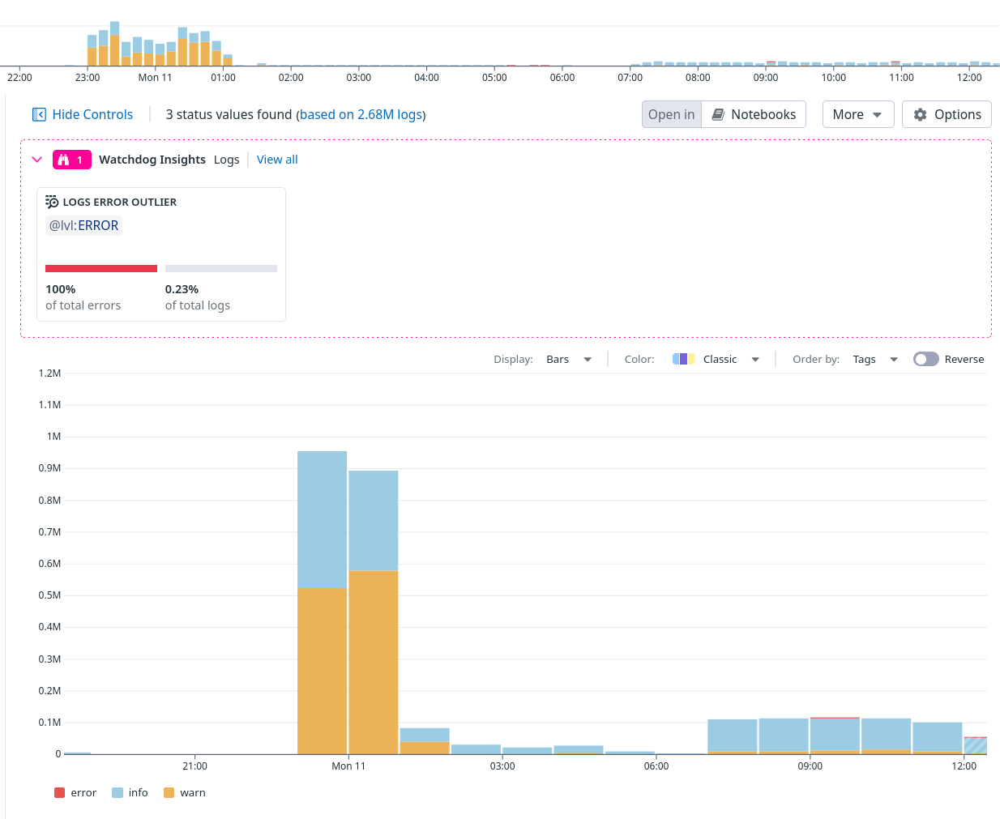

<!--
This presentation is written in markdown, and should be formatted using marp
-->

<!-- _class: lead -->
# Logging in the Ocient Relational Database
### Balancing visibility, performance, compliance, and cost


---
<!--
These settings take effect for the remainder of the slides -->
<!-- header: '' -->
<!-- footer: 'Ocient Logging Strategy' -->
<!-- paginate: true -->


---

## Why Logging Matters

- Monitor system health  
- Diagnose problems quickly  
- Meet compliance requirements  
- Optimize operational efficiency


---

## Who Uses Logs?

- **Customers & Support:** Monitor system health via INFO/WARN/ERROR  
- **Monitoring Tools:** Automated anomaly detection  
- **Engineering & L3 Support:** DEBUG for root cause analysis  
- **QA Teams:** Detailed logs for validation & troubleshooting

<div class="note-box">
Developers: Its not all about you!
</div>  

---

## The Ocient Logging Strategy

- **Meaningful** – actionable and relevant  
- **Manageable** – avoid excess  
- **Secure** – protect PII  
- **Standardized** across teams & components

---

## Off-Box vs On-Box Rules

- **ERROR, WARN, INFO** → Central repos (DataDog, GreyLog)  
- **DEBUG** → Local logs only  

We are never going to send all **Debug** logs off box automatically!

- we may collect them on request

---


---

## The Good News

We have a great track record of debugging problems with the logs we have

- without asking for recreation
- debug-always is pretty cool...

No debuggers in production environments

---

## The Bad News...

---

## DataDog



---

## The Seven Log Levels

1. **ERROR** – Critical, actionable  
2. **WARN** – Potential issues  
3. **INFO** – Routine operations  
4. **VERBOSE** – Extra context (undefined use)  
5. **DEBUG** – Detailed diagnostics  
6. **EDEBUG** – Excess debug (removed from production code)  
7. **EEDEBUG** – Extreme debugging (removed from production code)

---

## Best Practices for Log Levels

- Avoid ERROR for normal events (e.g., cluster startup)  
- Consider the log consumer before choosing the logging level  
- Keep INFO/WARN/DEBUG messages clear, actionable, and concise
- Provide context in the message (e.g. query ID)

---

## Sunny Day vs Rainy Day Logging

- **Sunny Day:** Informative yet concise logs  
- **Rainy Day:** Still concise, avoid flood of errors  

e.g. A node going down should not generate thousands of ERROR logs per second

---

## DEBUG Log Considerations

- Only stored on node disks  
- Can still:
  - Be hard to analyze if too large  
  - Increase transfer sizes  
  - Affect disk I/O performance

---

## getlogs

```shell
$ ocutil getlogs --help
Usage: ocutil.py getlogs [OPTIONS]

  Ocient Log Collector Tool

Options:
  --start TEXT              Get logs starting at this time
  --end TEXT                Get logs through this time
  --logfiles-location TEXT  The path to the log files
  --skip-rolehostd-log      If set, skip rolehostd.log
  --skip-query-json         If set, skip query.json
  --skip-security-json      If set, skip security.json
  --skip-syslog             If set, skip /var/log/syslog on Ubuntu and
                            /var/log/messages on CentOS
  --skip-lat-logs           If set, skip /var/log/lat
  --verbose                 When set, the tool log at DEBUG, otherwise it logs
                            at INFO
  --tag TEXT                If set, this will be the name of the archive,
                            otherwise archive name will be derived from
                            --start or --end
  --conf-path TEXT          The path to the rolehostd.conf file. If not set,
                            defaults to /var/opt/ocient/rolehostd.conf
  --help                    Show this message and exit.

```

---

## Structured Logging & Correlation

- Include correlation IDs (query/task IDs)  
- Best practices:
  - Consistent formats  
  - Propagate IDs across operations  
  - Scoped loggers to add IDs automatically

<div class="note-box">
We are not consistent in the IDs we log.
</div>


```shell
$ grep 33d5e964-b91c-464d-8bb5-f1b378a71702 rolehostd.log
```

---

## Alerting Strategy – ERROR

- Automatic alerts for ERROR logs  
- Each ERROR should be actionable  

<div class="note-box">
REGEX is evil!

- for whitelisting OR blacklisting
</div>

---

## Alerting Strategy – WARN

- Use frequency thresholds:
  - High criticality: 5+ WARN in 10 minutes  
  - Standard: 20+ in 1 hour  
  - Background: 50+ in 4 hours  
- Include correlation IDs in alert messages

---

## Personally Identifiable Information & Redaction

Some customers (e.g. telcos) **require** that PII be hidden from logs.

- names, addresses, phone numbers, social insurance numbers, etc

Any SQL statement literal

- we redact command compiler statements
- recently had to fix redaction in I/O operators

---

## Redacting in the code

```c++
// Mark a string as text that should be redacted
std::string redacted = log::markRedaction(currentStatement, 
                                          log::REDACT::STATEMENT);

...

// Add redaction marks starting at character 2 and going for 8
newText = log::markRedaction(newText, REDACT::STATEMENT, 2, 8);
```

---

## Generating the string for output

```c++
auto originalString = log::redactString(s, log::REDACT::NONE);

auto redactedString = log::redactString(s, log::REDACT::STATEMENT);

```

---

## Microsoft Incident from 2020

Logs uploaded to their customer support database (think Jira) were exposed

The logs contained sensitive information

---

## Redaction Best Practices

- Mark sensitive data at source  
- Consistent patterns across components  
- Maintain dual streams:
  - Redacted (safe for monitoring/audits)  
  - Non-redacted (local troubleshooting)

---

## Logging Config: `rolehostd.conf`


```yaml
loggingConfig:
    ? ''
    :   allowLevel: debug
        appender:
            logFilePath: /var/opt/ocient/log/rolehostd.log
        appenders:
        -   appender:
                allowLevel: warn
                format: json
                logFilePath: /var/opt/ocient/log/structuredLog.jsonl
    query:
        allowLevel: info
        appender:
            format: json
            logFilePath: /var/opt/ocient/log/query.json
    security:
        allowLevel: info
        appender:
            format: json
            logFilePath: /var/opt/ocient/log/security.json
```

---

# Logging configuration

**type**:

- `file`
- `stdout`
- `udp` 
- `tcp`

**format**:

- `json`
- `text`
- `gelf` (graylog format)

---


## Configuring Redaction

```yaml
    - appender:
        logFilePath: /var/opt/ocient/logs/rolehostd_redacted.log
        redactions:
        - statement
```

**NOTE:** we curently only support `statement` redaction.

---

## Text Log Format

```text
[2025-08-11T00:00:27.888067][DEBUG][vmST107] systemTableDataBlockWriter_t:
   (bdb3be74-bf1c-548c-bbef-702759d533a0) Creating new streamLoaderTarget
```

- timestamp
- level (DEBUG)
- thread name (vmST107)
- logger name (systemTableDataBlockWriter_t)
- correlation ID (bdb3be74-bf1c-548c-bbef-702759d533a0)
- message


---

## JSON Log Format

```json
{
  "sys": "ur-sql0",
  "timestamp": 1754697651.964319140,
  "thread": "rest151",
  "lvl": "WARN",
  "src": "queryTimer_t",
  "msg": "Multiple calls to accountEnd(cmdcomp.queries.cache_lookup) for the same query"
}

```

---


---

## Logger Naming

```text
systemTableDataBlockWriter_t: (bdb3be74-bf1c-548c-bbef-702759d533a0)
```

Two parts to the name:

- logger name (systemTableDataBlockWriter_t)
- scope (bdb3be74-bf1c-548c-bbef-702759d533a0)

The name is used in:

- rolehostd.conf
- DDL commands

```DDL
ALTER NODE node_name ALTER LOG LEVEL SET 'systemTableDataBlockWriter_t' = 'DEBUG';
```

---

## Log Naming - Developer View

Logger names are hierarchical:

```c++
log::logSink_t log1("cmdCompServer", log::TOP_LEVEL_LOG_SINK);
log::logSink_t log2("lockServiceClient", log1);
```

The resulting log:

```text
cmdCompServer::lockServiceClient
```

```DDL
ALTER NODE node_name ALTER LOG LEVEL SET 'cmdCompServer' = 'INFO';
ALTER NODE node_name ALTER LOG LEVEL SET 'cmdCompServer::lockServiceClient' = 'DEBUG';
```

You could also configure either of those names in `rolehostd.conf`

---

## Log Naming: Developer Best Practices

```c++
log::logSink_t LOGGER(log::logCategory_t::metadata);

...

log::logSink_t LOGGER("gdc", metadataLogger);
```

---

## Scoped Logs

A `log::scopedLogSink_t` is a logger with a dynamic piece of information attached

- e.g. a query ID or operator ID

You cannot specify the "scope" in a DDL statement or config file

```c++
log::scopedLogSink_t LOGGER(metadataLogger, uuid::to_string(queryId));
```

---

## Logger REST Endpoint

```rest
https://node:9090/v1/loggers
```

```json
  {
    "name": "protocol::roleResolver",
    "parent": "protocol"
  },
  {
    "name": "mutableDataBlock_t::finalize()",
    "parent": ""
  },
  {
    "name": "vmClusterHelper",
    "parent": ""
  },
    {
    "name": "protocol::healthProtocol",
    "parent": "protocol"
  },
  {
    "name": "metadataStorageCluster",
    "parent": ""
  },

```

---

## Things we do wrong...

```c++
// Include :: in logger names
log::logSink_t LOGGER("mutableDataBlock_t::finalize()");

// Only use the log sink
log::logSink_t LOGGER(log::TOP_LEVEL_LOG_SINK, 
                      "op[" + std::to_string(m_runtimeId) + "]" + queryIdStr + typeStr);

// log names with correlation IDs
log::logSink_t LOGGER("gdsTable_t(" + uuid::to_string(tableId) + ")");

```

--- 

## Things we do wrong... IDs in the log names

```json
  {
    "name": "gdsTable_t(4431d36a-7d46-4b9c-a0c6-7047079ee233)",
    "parent": ""
  },
  {
    "name": "gdsTable_t(d9dec42b-5d03-440f-ada9-89c555ca7ee8)",
    "parent": ""
  },
  {
    "name": "gdsTable_t(1802d90b-2898-4f6d-bc8c-f901182d885a)",
    "parent": ""
  },
  {
    "name": "gdsTable_t(5e8b1cbc-369a-4a8e-819c-fdbfcb3fd34b)",
    "parent": ""
  },
  {
    "name": "gdsTable_t(a01cc652-32d5-4fde-a62c-f1b0497746d4)",
    "parent": ""
  },

```


---

## Recent Issues

1) A component was logging PII.  Could not disable specific logs with DDL because the log names included IDs

2) A component generated millions of different unique log names, blew out the heap

---

## Developer Guidelines

- Understand what a logger name is
- Understand what a log scope is

- Use correct log levels and correlation IDs  
- Follow redaction rules strictly  

---

## Log Count REST endpoint

```rest
https://node:9090/v1/loggers/logcount
```

```json
{
  "values": [
    {
      "file": "libxgdb/src/db/vm/vmprotocol/action/executePlanAction.cpp",
      "line": 540,
      "count": 994671,
      "count_per_minute": 146,
      "level": "DEBUG",
      "sinkName": "protocol::vm"
    },
    {
      "file": "libxgdb/src/db/vm/vmprotocol/action/executePlanAction.cpp",
      "line": 2776,
      "count": 984355,
      "count_per_minute": 144,
      "level": "DEBUG",
      "sinkName": "protocol::vm"
    },
    {
      "file": "libxgservices/src/protocol/networkClient.cpp",
      "line": 215,
      "count": 734815,
      "count_per_minute": 108,
      "level": "DEBUG",
      "sinkName": "protocol::networkClient"
    },
```

---

## Log count REST endpoint 

Takes some parameters:

- **limit**: the number of loggers to return
- **level**: the log level to return
- **prefix**: filter on logger prefix

```rest
http://ur-sql0:9090/v1/logcount?limit=3&level=info&prefix=t'
```

---

## Current Hygene Work

- Make it actually possible to log `INFO` and above to datadog
- Fix logger names and scopes

Using Stefan's log reports

Knut is working on a PR that would force logger names to be compile time strings

---

## Future Enhancements

- Actually implement per-component log level control at runtime  
- Optionally remove file/line info for high-security configs

---

## Key Takeaways

- Logging serves **everyone** – but needs discipline  
- Keep logs actionable, concise, and secure  
- Developers: Follow levels, correlation, and redaction rules

---

## Q&A

